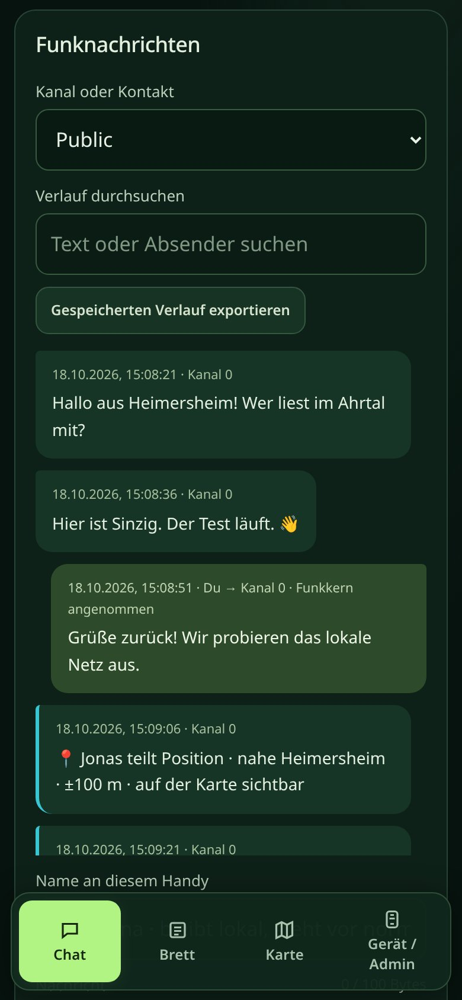
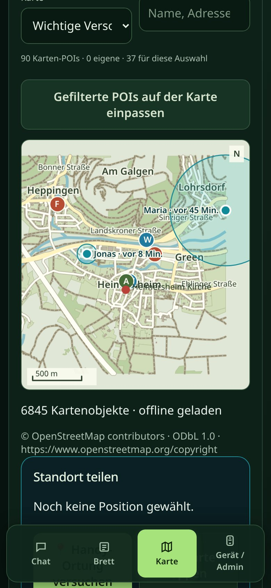

# DisasterMesh

**DisAHRsterRadio fürs Ahrtal: LoRa-Funknetz auf Basis von MeshCore mit der großen Weboberfläche MeshAhrtal – Chat, Schwarzes Brett und Offlinekarten im Handy-Browser, ohne Internet und Mobilfunk.**

Aufnahmen der [Live-Demo](https://pietwars.github.io/DisasterMesh/demo/) in Handygröße – Stand 0.9.2, alles simuliert.

**Version 0.9.2 · Entwicklungsprototyp · MeshCore 1.18.0** · Weboberfläche MeshAhrtal · 868 MHz

Flyer (A5): [Druck-PDF mit QR-Codes](docs/flyer/DisasterMesh-Flyer.pdf) · [Digital-PDF mit Links](docs/flyer/DisasterMesh-Flyer-digital.pdf) · [Vorschau](docs/flyer/DisasterMesh-Flyer-vorschau.jpg)

## Was kann es

- **Chat:** Kanalchat und Direktnachrichten über MeshCore, Verlaufssuche und JSON-Export
- **Schwarzes Brett:** Room-Server mit dem öffentlichen Gast-Passwort `hello` (die Weboberfläche tritt automatisch bei), Vorlagen Hilfe / Angebot / Info
- **Schnellmeldungen:** Trinkwasser, Strom, Medikamente, Verletzt, Evakuierung, „Mir geht es gut“ – mit 14 Ahrtal-Orten von Schuld bis Kripp
- **Standort teilen:** Ortsliste, Karte antippen oder GPS-Modul; kompakt als `!DP1` mit Genauigkeit grob/mittel/fein
- **Offlinekarten:** Ahrtal von der Quelle bis zur Mündung, Heimersheim mit Gebäuden und weitere Ortsabschnitte; Versorgungspunkte aus OpenStreetMap und eigene POIs
- **Gerät:** Diagnose, Knotenname, Funkprofile und Kanäle (Betreiber mit Admin-Passwort), optionales SD-Archiv

## Unterstützte Geräte

| Board | Paket im [Release v0.9.2](https://github.com/Pietwars/DisasterMesh/releases/tag/v0.9.2) | Stand |
|---|---|---|
| Heltec WiFi LoRa 32 V2 (ESP32, SX1276, 868 MHz) | `DisasterMesh-0.9.2-heltec-v2.zip` | baut und ist automatisch geprüft; 0.9.2 nicht auf Hardware abgenommen |

Weitere Boards (LILYGO T3-S3, T3 V1.6.1, Repeater- und Room-Server-Profile) bleiben im Code, sind aber nicht im Release – siehe [Details](docs/DETAILS.md#hardware).

**Ab dem nächsten Release** (vorbereitet, noch nicht veröffentlicht): Pakete nur noch für **LILYGO T-Deck Plus** (`…-tdeck.zip`) und **LILYGO T-Watch S3** (`…-twatch-s3.zip`), beide ESP32-S3 mit SX1262. Das Display zeigt nur das DisAHRsterRadio-Bild, eine Akkuzeile und den Knopf „Advert senden“; alles andere läuft über die Weboberfläche. Beide bauen und sind automatisch geprüft, aber noch nicht auf Hardware abgenommen. Heltec V2 ist dann nicht mehr im Release (bleibt im Code).

## Schnellstart

1. **Flashen:** ZIP aus dem [Release](https://github.com/Pietwars/DisasterMesh/releases/tag/v0.9.2) entpacken und `DisasterMesh-0.9.2-heltec-v2-factory.bin` an Adresse **0x0** schreiben (z. B. mit esptool; überschreibt Einstellungen und Verlauf). Anleitung liegt als `ANLEITUNG.md` im ZIP.
2. **Verbinden:** Handy mit dem offenen WLAN `DisAHRsterRadio-XXXXXX` verbinden, **http://192.168.4.1** öffnen – kein Passwort nötig.
3. **Nur Betreiber:** Beim ersten Start zeigt der USB-Seriellmonitor (115200 Baud) das gerätespezifische Admin-Passwort für Funkprofil und Kanäle.

Bluetooth und die MeshCore-App sind im Release-Build für Heltec V2 nicht enthalten. Mehr: [Offener Zugang](docs/OFFENER_ZUGANG.md) · [Startpaket](docs/STARTPAKET.md) · [Flashen mit Sicherung](docs/SX1262_PAKET.md)

## Funk

MeshCore-Preset **EU/UK (Narrow): 869,618 MHz**, 62,5 kHz, SF8, CR 4/8 (SRD-Teilband 869,4–869,65 MHz, 10 % Sendezeit). Alle Knoten eines Netzes brauchen dasselbe Profil. Spricht mit anderen MeshCore-Geräten, nicht mit LoRaLayer2 oder Meshtastic.

<!-- projektfamilie:start (in allen fünf Repositorys identisch; erzeugt mit DisasterMesh/tools/projektfamilie.py) -->
## Projektfamilie DisAHRsterRadio / HaldenFunk

| Repository | Inhalt | Funk | Version | Demo · Download · Flyer |
|---|---|---|---|---|
| [Pietwars/DisasterMesh](https://github.com/Pietwars/DisasterMesh) | Original-Repo: MeshCore 1.18 mit der großen Weboberfläche MeshAhrtal, Karten, Werkzeuge, Doku (Ahrtal) | MeshCore | 0.9.2 | [Live-Demo](https://pietwars.github.io/DisasterMesh/demo/) · [Release v0.9.2](https://github.com/Pietwars/DisasterMesh/releases/tag/v0.9.2) · Flyer [Druck](https://pietwars.github.io/DisasterMesh/flyer/DisasterMesh-Flyer.pdf) / [digital](https://pietwars.github.io/DisasterMesh/flyer/DisasterMesh-Flyer-digital.pdf) |
| [Pietwars/DisAHRsterRadio-MeshCore](https://github.com/Pietwars/DisAHRsterRadio-MeshCore) | MeshCore 1.18 mit kompakter MeshAhrtal-Oberfläche per WLAN plus Bluetooth für die MeshCore-App; Firmware für LILYGO T-Deck Plus und Heltec V2 (Ahrtal) | MeshCore | 0.9.1 | [Live-Demo](https://pietwars.github.io/DisAHRsterRadio-MeshCore/) · [Release v0.9.1](https://github.com/Pietwars/DisAHRsterRadio-MeshCore/releases/tag/v0.9.1) · Flyer [Druck](https://pietwars.github.io/DisAHRsterRadio-MeshCore/flyer/DisAHRsterRadio-MeshCore-Flyer.pdf) / [digital](https://pietwars.github.io/DisAHRsterRadio-MeshCore/flyer/DisAHRsterRadio-MeshCore-Flyer-digital.pdf) |
| [Pietwars/DisAHRsterRadio](https://github.com/Pietwars/DisAHRsterRadio) | Ohne MeshCore: modernisiertes disaster-radio (LoRaLayer2, RadioLib) mit kompakter MeshAhrtal-Oberfläche (Ahrtal) | LoRaLayer2 | 0.9.1 | [Live-Demo](https://pietwars.github.io/DisAHRsterRadio/) · [Release v0.9.1](https://github.com/Pietwars/DisAHRsterRadio/releases/tag/v0.9.1) · Flyer [Druck](https://pietwars.github.io/DisAHRsterRadio/flyer/DisAHRsterRadio-Flyer.pdf) / [digital](https://pietwars.github.io/DisAHRsterRadio/flyer/DisAHRsterRadio-Flyer-digital.pdf) |
| [Pietwars/HaldenFunk](https://github.com/Pietwars/HaldenFunk) | Regionalvariante von DisAHRsterRadio für Sangerhausen / Mansfelder Land, ohne MeshCore | LoRaLayer2 | 0.9.1 | [Live-Demo](https://pietwars.github.io/HaldenFunk/) · [Release v0.9.1](https://github.com/Pietwars/HaldenFunk/releases/tag/v0.9.1) · Flyer [Druck](https://pietwars.github.io/HaldenFunk/flyer/HaldenFunk-Flyer.pdf) / [digital](https://pietwars.github.io/HaldenFunk/flyer/HaldenFunk-Flyer-digital.pdf) |
| [Pietwars/HaldenFunk-MeshCore](https://github.com/Pietwars/HaldenFunk-MeshCore) | Regionalvariante von DisAHRsterRadio-MeshCore für das Mansfelder Land: MeshCore 1.18, WLAN + Bluetooth, Gerätematrix | MeshCore | 0.9.1 | [Live-Demo](https://pietwars.github.io/HaldenFunk-MeshCore/) · [Release v0.9.1](https://github.com/Pietwars/HaldenFunk-MeshCore/releases/tag/v0.9.1) · Flyer [Druck](https://pietwars.github.io/HaldenFunk-MeshCore/flyer/HaldenFunk-MeshCore-Flyer.pdf) / [digital](https://pietwars.github.io/HaldenFunk-MeshCore/flyer/HaldenFunk-MeshCore-Flyer-digital.pdf) |

Gleiche Spalte **Funk** = Geräte können miteinander funken (gleiches Funkprofil vorausgesetzt). MeshCore- und LoRaLayer2-Varianten verstehen sich **nicht**.

**Namen:** **DisAHRsterRadio** = Projekt und Marke (WLAN `DisAHRsterRadio-XXXXXX`) · **MeshAhrtal** = die Weboberfläche im Handy-Browser · **DisasterMesh** = das Original-Repository · **HaldenFunk – Glück Auf** = Regionalvariante fürs Mansfelder Land (WLAN `HaldenFunk-XXXXXX`).

Alle Demos sind simuliert.
<!-- projektfamilie:end -->

## Sicherheit

> ⚠️ Prototyp, **kein zertifiziertes Notrufsystem**. Im Notfall immer **112** wählen. Verlauf und eigene POIs sind unverschlüsselt gespeichert; Positionen im Kanal sind für alle Kanalteilnehmer lesbar.

## Mehr Doku

[Details (ausführlich)](docs/DETAILS.md) · [GPS und Standort](docs/GPS_UND_STANDORT.md) · [Automatische Karten](docs/AUTOMATISCHE_KARTEN.md) · [Validierung](docs/VALIDIERUNG.md) · [Architektur](docs/ARCHITEKTUR.md) · [Änderungen](CHANGELOG.md)

## Lizenz

Code: [MIT](LICENSE). MeshCore und weitere Komponenten unter eigenen Lizenzen ([Quellen und Lizenzen](docs/QUELLEN_UND_LIZENZEN.md)). Kartendaten © [OpenStreetMap](https://www.openstreetmap.org/copyright)-Mitwirkende, [ODbL 1.0](maps/ODbL-1.0.txt). Foto und Startbild © Pietwars, nicht unter MIT.
