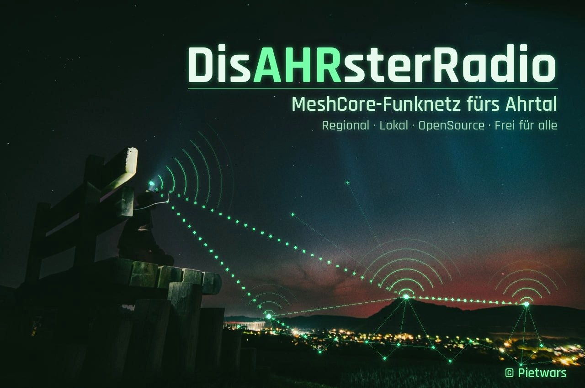

# DisAHRsterRadio

[](docs/images/disahrsterradio-header.jpg)

**Lokale Kommunikation im Ahrtal – auch ohne Internet, Strom- oder Mobilfunknetz.** DisAHRsterRadio verbindet LoRa-Funkknoten auf Basis von [MeshCore](https://github.com/meshcore-dev/MeshCore) mit einer deutschen Weboberfläche im Handy-Browser: Chat, Schwarzes Brett, Schnellmeldungen, Offlinekarten und Standort teilen. Der Name trägt die Ahr in sich und erinnert an die Flut im Juli 2021.

**Version 0.9.0-alpha · Entwicklungsprototyp · MeshCore 1.18.0 · LILYGO T3-S3 V1.3 (SX1262/SX1276), LILYGO T3 V1.6.1 (SX1276), Heltec WiFi LoRa 32 V2 (SX1276) · 868 MHz**

> ⚠️ Kein geprüftes Notfunksystem und kein Ersatz für den Notruf **112**. Software und Firmware-Builds sind automatisch geprüft. Hardware: LILYGO T3 V1.6.1 lief beim Nutzer mit der Schwester-Firmware DisAHRsterRadio vollständig (OLED, WLAN, Weboberfläche, Chat, LoRa-Empfang); diese 0.9.0-alpha selbst ist **auf keinem Board abgenommen**. Heltec V2 hat ein Strom-/Brownout-Problem (WLAN-AP erschien nicht), 0.9.0-alpha enthält einen gestaffelten WLAN-Start als Gegenmaßnahme – ungeprüft. Funkreichweite, GPS-Modul, Stromaufnahme und iPhone sind nicht abgenommen.

<!-- projektfamilie:start (in allen drei Repositorys identisch) -->
### Projektfamilie DisAHRsterRadio

| Repository | Inhalt | Version | Demo · Download · Flyer |
|---|---|---|---|
| [Pietwars/DisasterMesh](https://github.com/Pietwars/DisasterMesh) | Original-Repo: MeshCore 1.18 mit der großen Weboberfläche MeshAhrtal, Karten, Werkzeuge, Doku | 0.9.0-alpha | [Live-Demo](https://pietwars.github.io/DisasterMesh/demo/) · [Projektseite](https://pietwars.github.io/DisasterMesh/) · Firmware über [Actions](https://github.com/Pietwars/DisasterMesh/actions) · Flyer [Druck](https://pietwars.github.io/DisasterMesh/flyer/DisasterMesh-Flyer.pdf) / [digital](https://pietwars.github.io/DisasterMesh/flyer/DisasterMesh-Flyer-digital.pdf) |
| [Pietwars/DisAHRsterRadio-MeshCore](https://github.com/Pietwars/DisAHRsterRadio-MeshCore) | MeshCore 1.18 mit kompakter MeshAhrtal-Oberfläche per WLAN plus Bluetooth für die MeshCore-App, 105 Geräte | 0.9.0-alpha | [Live-Demo](https://pietwars.github.io/DisAHRsterRadio-MeshCore/) · [Release v0.9.0-alpha](https://github.com/Pietwars/DisAHRsterRadio-MeshCore/releases/tag/v0.9.0-alpha) · Flyer [Druck](https://pietwars.github.io/DisAHRsterRadio-MeshCore/flyer/DisAHRsterRadio-MeshCore-Flyer.pdf) / [digital](https://pietwars.github.io/DisAHRsterRadio-MeshCore/flyer/DisAHRsterRadio-MeshCore-Flyer-digital.pdf) |
| [Pietwars/DisAHRsterRadio](https://github.com/Pietwars/DisAHRsterRadio) | Ohne MeshCore: modernisiertes disaster-radio (LoRaLayer2, RadioLib) mit kompakter MeshAhrtal-Oberfläche – nicht kompatibel zu MeshCore-Knoten | 0.1.1-dev | [Live-Demo](https://pietwars.github.io/DisAHRsterRadio/) · Firmware über [Actions](https://github.com/Pietwars/DisAHRsterRadio/actions) · Flyer [Druck](https://pietwars.github.io/DisAHRsterRadio/flyer/DisAHRsterRadio-Flyer.pdf) / [digital](https://pietwars.github.io/DisAHRsterRadio/flyer/DisAHRsterRadio-Flyer-digital.pdf) |

**Namen:** **DisAHRsterRadio** = Projekt und Marke (auch WLAN-Name `DisAHRsterRadio-XXXXXX`) · **MeshAhrtal** = die Weboberfläche im Handy-Browser · **DisasterMesh** = das Original-Repository.
Haupt-Boards: LILYGO T3-S3 V1.3, LILYGO T3 V1.6.1 (TTGO), Heltec WiFi LoRa 32 V2 – alle 868 MHz; Hardware-Abnahme steht aus (bisher lief nur LILYGO T3 V1.6.1 beim Nutzer). Druck-Flyer haben QR-Codes, digitale Flyer klickbare Links. Alle Demos sind simuliert.

> ⚠️ Prototyp, kein zertifiziertes Notrufsystem. **Im Notfall immer 112.**
<!-- projektfamilie:end -->

### English summary

DisAHRsterRadio is an offline LoRa mesh messenger for the Ahr valley (Germany), built on MeshCore. Each ESP32-S3 node (LILYGO T3-S3, SX1262, 868 MHz) opens its own Wi-Fi; phones use a German web UI (MeshAhrtal) for channel chat, direct messages, a bulletin board (room server), quick emergency templates, offline vector maps of the valley and opt-in position sharing (compact `!DP1` messages, coarse/medium/fine precision). An optional external NMEA GPS module is supported. Status: development prototype – CI-tested software and firmware builds, **not yet tested on real hardware**. Not a certified emergency system.

## Funktionen 0.9.0-alpha

| Bereich | Funktionen |
|---|---|
| Kommunikation | Kanalchat, Direktnachrichten, Kontakte, Verlaufssuche, JSON-Export, begrenzte Zustellaufträge |
| Schwarzes Brett | Room-Server mit Anmeldung, 32 Beiträge, Vorlagen Hilfe / Angebot / Info (`!DM1`), aktuelle Hilfe oben |
| Schnellmeldungen | Trinkwasser, Strom/Laden, Medikamente, Verletzt, Evakuierung, „Mir geht es gut“, Hilfe anbieten, Strom vorhanden |
| Ahrtal-Orte | 14 Orte von Schuld bis Kripp für Meldungen und Standort (gerundete Ortsmitten nach OSM) |
| Standort | Ortsliste, Karte antippen, Handy-Ortung (nur in sicherem Kontext), optionales GPS-Modul; Teilen als `!DP1` mit Genauigkeit grob/mittel/fein, höchstens alle 5 Minuten. [Details](docs/GPS_UND_STANDORT.md) |
| Offlinekarten | Ahrtal-Übersicht Quelle–Mündung, Heimersheim mit Gebäuden, Altenahr, Dernau/Ahrweiler, Sinzig; Speicherung auf dem Handy, automatische Aktualisierung bei Internet. [Karten](docs/AUTOMATISCHE_KARTEN.md) |
| Versorgung und eigene Orte | OSM-Versorgungspunkte (Wasser, Apotheke, Feuerwehr, Arzt, Lebensmittel, WC, Unterstand), eigene POIs und Erntefundorte, GeoJSON-Import/-Export |
| Gerät und Administration | Diagnose, Knotenname, Uhrzeit, Adminzugang, Chatkanäle, 868-MHz-Funkprofile, Verlauf löschen, optionales SD-Archiv |

## Schnellstart

1. **Demo ansehen:** [Live-Demo im Browser](https://pietwars.github.io/DisasterMesh/demo/) – Stand 0.9.0-alpha, alles simuliert, Demo-Adminpasswort `DemoAdmin2026!`. Offline: `python tools/build_demo.py` erzeugt dieselbe Demo in `docs/demo/`. Für 0.9.0-alpha gibt es kein Release; Demo-ZIP und [Startpaket](docs/STARTPAKET.md) in den [Releases](https://github.com/Pietwars/DisasterMesh/releases) sind ältere Stände (Demo 0.8.0, Startpaket 0.7.1.1).
2. **Firmware:** Builds der Workflows „Build T3-S3 V1.3“ und „Build DisAHRsterRadio TTGO“ unter [Actions](https://github.com/Pietwars/DisasterMesh/actions) (GitHub-Anmeldung nötig) oder selbst bauen (siehe unten). [Flashen mit Sicherung](docs/SX1262_PAKET.md) · [Startpaket und Windows](docs/STARTPAKET.md)
3. Vorherige Firmware und Einstellungen **lokal sichern**. Bei bestehender DisAHRsterRadio-Installation gleicher Rolle nur die Anwendung aktualisieren, **kein `uploadfs`**.
4. USB-Seriellmonitor (115200 Baud) öffnen, WLAN-Name und Passwörter ablesen.
5. Handy mit `DisAHRsterRadio-XXXXXX` verbinden, `http://192.168.4.1` öffnen. [Web-App auf dem iPhone](docs/AHRTAL_WEBAPP.md)
6. Knoten benennen, Uhr übernehmen, Funkprofil und Kanäle auf allen Boards abstimmen.
7. Erst zwei Boards direkt testen, dann Repeater und Room-Server ergänzen. [Abnahmeprotokoll](docs/ABNAHME_ZWEI_BOARDS.md)

## Hardware

Zielaufbau: **fünf LILYGO T3-S3 V1.3** (ESP32-S3, SX1262, 868-MHz-Antenne). [Board, Pins, Strom](docs/SX1262_BOARD.md) · [Fünf-Board-Aufbau](docs/T3S3_V13_WINDOWS.md)

| Boards | Rolle | Firmwareprofil |
|---|---|---|
| A und B | WLAN-Portal mit MeshAhrtal-Oberfläche | `disaster_t3s3_sx1262_wifi` |
| optional | WLAN-Portal mit SD-Archiv | `disaster_t3s3_sx1262_wifi_sd` |
| optional | WLAN-Portal mit GPS-Modul | `disaster_t3s3_sx1262_wifi_gps` |
| C und D | Repeater | `disaster_t3s3_sx1262_repeater` |
| E | Room-Server (Schwarzes Brett) | `disaster_t3s3_sx1262_room` |

Weitere Boards und Profile:

| Board | Rolle | Firmwareprofil | Stand |
|---|---|---|---|
| LILYGO T3-S3 V1.3 mit SX1276 | WLAN / Repeater / Room / SD | `disaster_t3s3_sx1276_*` | baut, ungeprüft |
| LILYGO T3 V1.6.1 (TTGO LoRa32 V2.1_1.6, SX1276) | WLAN-Portal | `disaster_tlora_v2_1_sx1276_wifi` | baut; Hardware mit DisAHRsterRadio geprüft |
| TTGO LoRa32 V2.1_1.6 | WLAN / SD / Repeater / Room | `disaster_ttgo_wifi`, `_wifi_sd`, `_repeater`, `_room` | baut, ungeprüft |
| Heltec WiFi LoRa 32 V2 (SX1276) | WLAN-Portal (WLAN 8,5 dBm, 2 s später gestartet) | `disaster_heltec_v2_sx1276_wifi` | baut; Brownout-Problem bekannt |
| Heltec WiFi LoRa 32 V2 | Diagnose (Boot-Marker seriell) | `disaster_heltec_v2_sx1276_wifi_diag` | baut |

Firmware nie auf eine andere Funkchip-Variante flashen. Meshtastic-Knoten sprechen nicht mit MeshCore. WLAN-Name `DisAHRsterRadio-XXXXXX`; das Passwort wird pro Gerät zufällig erzeugt und seriell (115200 Baud) sowie auf dem OLED angezeigt.

**Optionales GPS-Modul** (NMEA, 9600 Baud, z. B. ATGM336H, NEO-6M, L76K) – nicht an Hardware geprüft:

| Modul | T3-S3 |
|---|---|
| VCC | 3V3 |
| GND | GND |
| TX | GPIO 44 |
| RX | GPIO 43 |

## Vorschauen

Echte Browseraufnahmen der Demo; Geräte- und Funkwerte sind simuliert.

  

| | | |
|---|---|---|
| [](docs/images/funktion-chat.png) Chat | [](docs/images/funktion-brett.png) Schwarzes Brett | [](docs/images/funktion-meldungen.png) Meldungsvorlagen |
| [](docs/images/funktion-kartendownload.png) Kartendownload | [](docs/images/funktion-versorgung.png) Versorgung | [](docs/images/funktion-eigene-pois.png) Eigene POIs |
| [](docs/images/ahrtal-admin.png) Adminzugang | [](docs/images/funktion-diagnose.png) Diagnose | [](docs/images/funktion-funkprofile.png) Funkprofile |

Weitere: [Desktop](docs/images/ahrtal-desktop.png) · [Direktnachrichten](docs/images/funktion-direktnachrichten.png) · [Kanäle](docs/images/funktion-kanaele.png) · [Knoten](docs/images/funktion-knoten.png) · [Zustellaufträge/SD](docs/images/funktion-auftraege-sd.png) · [Erntefundorte](docs/images/funktion-erntefundorte.png) · [Heimersheim-Karte](docs/images/heimersheim-map.png)

## Status und Grenzen

- **Prototyp.** Nicht zertifiziert, kein Anschluss an Leitstellen, keine Funkpriorität für Hilferufe.
- **Hardware ungeprüft:** Funk, Reichweite, Repeater, Room-Server über Neustart, Stromausfall, SD-Last, GPS-Modul, Stromaufnahme, echtes iPhone/Android. Siehe [Validierung](docs/VALIDIERUNG.md), [Entwicklungsplan](docs/ENTWICKLUNGSPLAN.md), [iPhone](docs/IOS_REALITAET.md), [Strom](docs/STROM_UND_SCHLAF.md).
- Handy-Ortung ist über `http://192.168.4.1` vom Browser gesperrt; Ortsliste, Karte oder GPS-Modul verwenden.
- Alle WLAN-Nutzer eines Boards teilen eine Knotenidentität. Verlauf im Flash, eigene POIs und Exporte sind **unverschlüsselt**.
- Positionen im Kanal sind für alle mit dem Kanalschlüssel lesbar (im Public-Kanal für alle).
- Karten müssen **vor** dem Ausfall auf dem Handy liegen; keine Karteninhalte über Funk.
- Im Ordner `dist/` liegen bewusst keine Firmwaredateien ([Hinweis](dist/LESEN.md)).

## Entwicklung und Tests

Benötigt: Python 3, Node.js 20, Git, PlatformIO 6.2.

```sh
npm ci --omit=optional && npm test          # JS-Tests ohne Browser
python tests/tools.test.py                   # Python-Tests: tests/*.test.py
g++ -std=c++17 -I tests/fakes tests/history.test.cpp -o /tmp/t && /tmp/t   # C++-Tests: tests/*.test.cpp
python tools/embed_web.py                    # Oberfläche in die Firmware einbetten
python -m platformio run -d firmware/MeshCore -e disaster_t3s3_sx1262_wifi
```

Browserprüfungen und Vorschauen: `npm ci && npx playwright install chromium`, dann `npm run test:browser`, `python tools/build_demo.py`, `node tools/capture_previews.cjs`.

CI ([Actions](https://github.com/Pietwars/DisasterMesh/actions)): „Tests“ (JS, Python, C++), „Build DisAHRsterRadio TTGO“ (TTGO-, T3-V1.6.1- und Heltec-Profile + Browser), „Build T3-S3 V1.3“ (8 Profile + GPS-Profil, Windows-Pakete), „Windows MVP checks“.

Weitere Doku: [Architektur](docs/ARCHITEKTUR.md) · [Windows-Entwicklung](docs/WINDOWS_MVP.md) · [MeshCore-Anpassungen](docs/UPSTREAM.md) · [Änderungen](CHANGELOG.md)

## Mitmachen

Fehler und Ideen bitte als [Issue](https://github.com/Pietwars/DisasterMesh/issues). Pull Requests gegen `main`; alle Checks müssen grün sein. Dokumentation und Oberfläche sind auf Deutsch. Hardware-Testberichte (zwei Boards, Repeater, iPhone, GPS-Modul) mit dem [Abnahmeprotokoll](docs/ABNAHME_ZWEI_BOARDS.md) sind besonders willkommen.

**Flyer (A5):** [Druck-PDF mit QR-Codes](docs/flyer/DisasterMesh-Flyer.pdf) · [Digital-PDF mit klickbaren Links](docs/flyer/DisasterMesh-Flyer-digital.pdf) · [Vorschau](docs/flyer/DisasterMesh-Flyer-vorschau.jpg); Druckquelle `docs/flyer/flyer.html`, PDF neu erzeugen mit `node tools/build_flyer.cjs`. **Projektseite:** Quelle `docs/site/index.html`, lokal bauen mit `python tools/build_site.py` (Seite, Bilder und Live-Demo in `_site/`); Veröffentlichung über den Workflow „Projektseite (GitHub Pages)“.

## Lizenz und Quellen

- Code: [MIT](LICENSE). MeshCore und weitere Komponenten unter ihren eigenen Lizenzen, siehe [Quellen und Lizenzen](docs/QUELLEN_UND_LIZENZEN.md).
- Kartendaten: © [OpenStreetMap](https://www.openstreetmap.org/copyright)-Mitwirkende, [ODbL 1.0](maps/ODbL-1.0.txt).
- Foto und Startbild: © Pietwars, nicht unter MIT ([Bildquellen](web/assets/README.md)). Schrift im Startbild: Rajdhani (SIL Open Font License).
