# DisAHRsterRadio · MeshAhrtal

Öffentlicher Name: **DisAHRsterRadio**. MeshAhrtal ist die Oberfläche, DisasterMesh der Name dieses Repositories.

Lokale Kommunikation im Ahrtal – auch ohne Internet. DisAHRsterRadio verbindet MeshCore mit einer deutschen Weboberfläche für **Chat, Schwarzes Brett, Offlinekarten und eigene Alltags-POIs**. Der Name verbindet DisAHRsterRadio mit der Ahr und erinnert an die Flut im Juli 2021.

**Version 0.8.0 · Entwicklungsprototyp · LILYGO T3-S3 V1.3 / SX1262 / 868 MHz**

Zwölf Firmwareprofile, Browserprüfungen und Windows-Prüflauf erfolgreich. Die Abnahme mit echten Boards und auf einem echten iPhone steht aus. Kein Ersatz für ein geprüftes Notrufsystem.

## Demo starten und herunterladen

[**Startpaket mit interaktiver Demo herunterladen**](https://github.com/Pietwars/DisasterMesh/releases/latest) · [**Firmware-Downloads und Windows-Einrichtung**](docs/STARTPAKET.md) · [Prüfstand](docs/VALIDIERUNG.md) · [Änderungen](CHANGELOG.md)

1. Startpaket vollständig entpacken und **`START.html`** öffnen.
2. **„Aktuelle Demo öffnen“** wählen; die Oberfläche liegt unter `demo/index.html`.
3. Chat, Brett, Karte und Gerät/Admin ausprobieren. Demo-Adminpasswort: **`DemoAdmin2026!`**.

Die Demo verwendet die echte Weboberfläche. Nachrichten, Gerätezustand, Anmeldung und Funkprofilwechsel sind **simuliert**; kein Board wird gesteuert. Die eingebettete Regional-Karte enthält reale OSM-Daten. Eigene POIs und Erntefundorte werden lokal im Browser verwaltet. Unter `file://` kann der Browser die dauerhafte Speicherung beschränken; Demo und Board haben getrennte Speicher. GitHub zeigt HTML-Dateien als Quelltext an – die Demo deshalb aus dem entpackten Paket öffnen.

[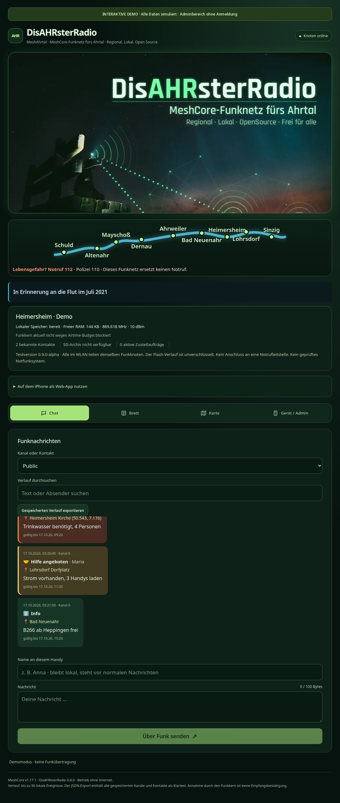](https://github.com/Pietwars/DisasterMesh/releases/latest)

## Aktueller Funktionsumfang

| Bereich | Funktionen |
|---|---|
| Kommunikation | Kanalchat, Direktnachrichten, Kontakte, Verlaufssuche und JSON-Export |
| Schwarzes Brett | Room-Server, Anmeldung, Beiträge und Hilfe-/Angebot-/Info-Vorlagen |
| Offlinekarte | Reale regionale Vektordaten, verschieben/zoomen, Maßstab, Import/Export und Speicherung auf dem Handy |
| Automatische Karten | Bei geöffneter App und Internetverbindung herunterladen bzw. täglich aktualisieren |
| Versorgung | Wasser/Quellen, Apotheken, Feuerwehr, ärztliche Versorgung; zusätzlich Lebensmittel, Toiletten und Unterstände |
| Eigene POIs | Auf der Karte oder per Koordinaten anlegen, bearbeiten, löschen, filtern, suchen und als GeoJSON sichern |
| Eigene Erntefundorte | Optionale lokale Sammlung mit Kategorien, Erntemonaten und Import/Export |
| Standort | Ortsliste im Ahrtal, Karte antippen, Handy-Ortung (nur HTTPS) oder optionales GPS-Modul; Teilen als kompakte `!DP1`-Meldung mit wählbarer Genauigkeit. [Details](docs/GPS_UND_STANDORT.md) |
| Gerät und Administration | Diagnose, Knotenname, Uhrzeit, Kontakte, Adminzugang, Chatkanäle und 868-MHz-Funkprofile |
| Zustellung und Archiv | Begrenzte private Zustellaufträge; optional zwei rotierende SD-Archivsegmente mit passender SD-Firmware |

## Vorschauen der einzelnen Funktionen

### Neu in 0.8.0: Startbild, Schnellmeldungen und Standort

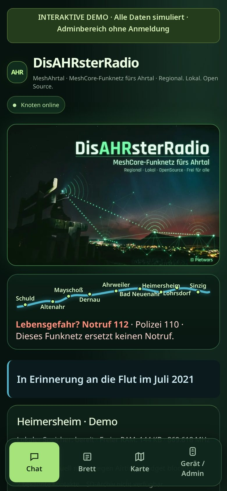 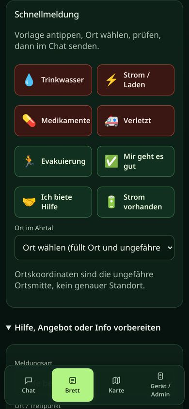 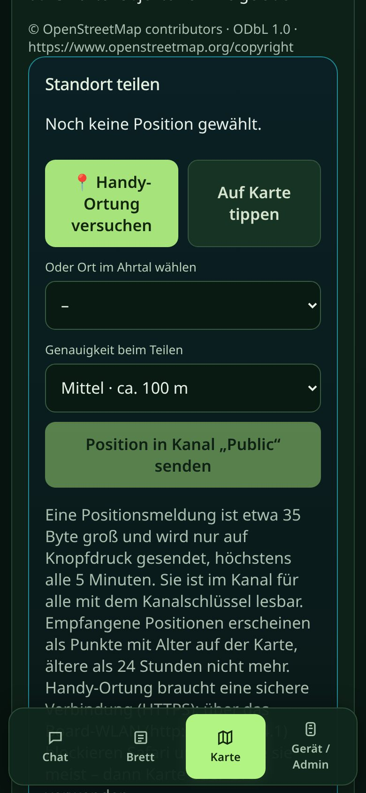

Alle folgenden Bilder sind echte Browseraufnahmen der aktuellen Demo. Simulierte Geräte- und Funkwerte sind keine Hardware-Messergebnisse. Reale OSM-Orte sind keine Bestätigung aktueller Verfügbarkeit. Bilder anklicken, um sie in voller Größe zu öffnen.

### Kanalchat und Verlauf

Kanäle und persönliche Kontakte auswählen, Nachrichten suchen und den lokalen Verlauf exportieren. Bis zu 96 Nachrichten-/Bestätigungsereignisse werden auf dem Board persistent gespeichert. Annahme durch den Funkkern und Empfangsbestätigung sind getrennt; Kanalnachrichten haben keine individuelle Zustellbestätigung.

[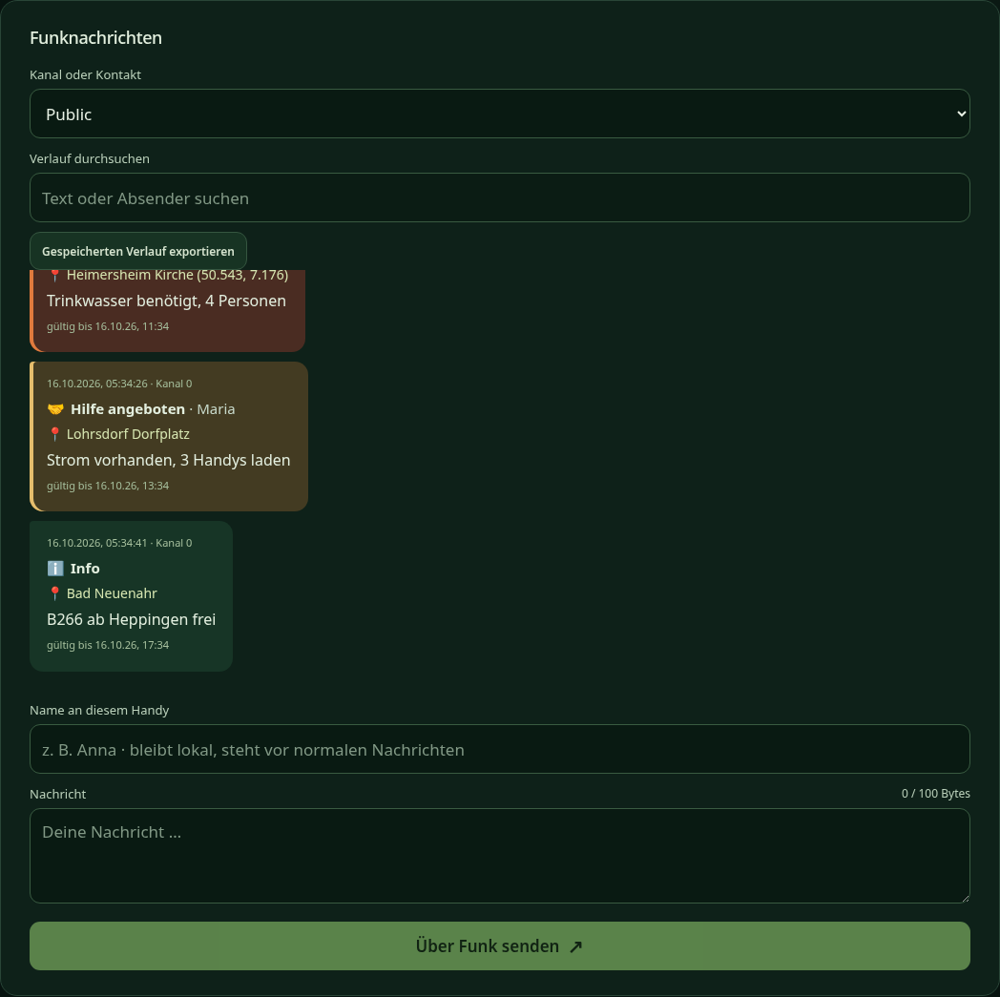](docs/images/funktion-chat.png)

### Direktnachrichten und private Zustellaufträge

Bekannte Chat-Kontakte direkt anschreiben. Optional bis zu acht persistente Aufträge mit Ablaufzeit und maximal vier Versuchen; der Absender muss eingeschaltet bleiben. Kein privates Zwischenknoten-Postfach.

[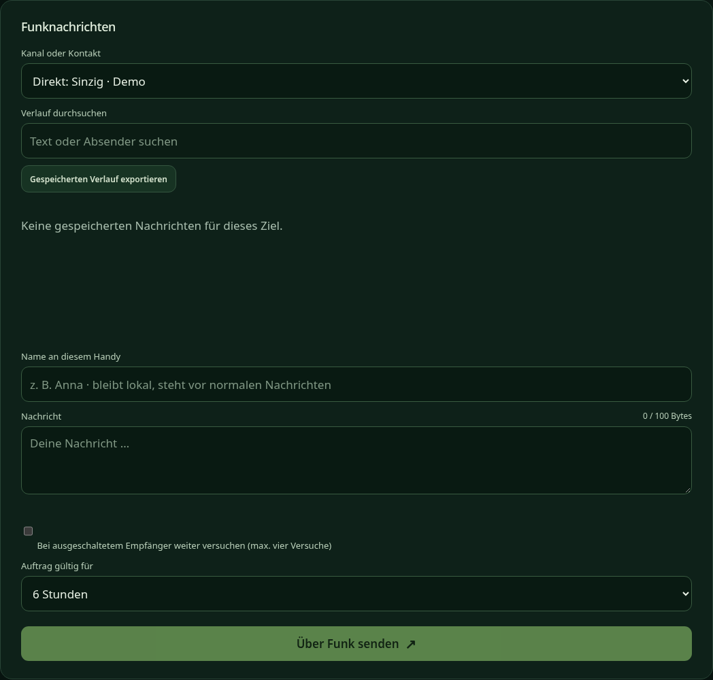](docs/images/funktion-direktnachrichten.png)

### Schwarzes Brett und Room-Server

Raumserver auswählen, anmelden und Beiträge abrufen. Das separate Room-Profil hält bis zu 32 Beiträge im persistenten Ring. [Windows-Anleitung](docs/SCHWARZES_BRETT.md).

[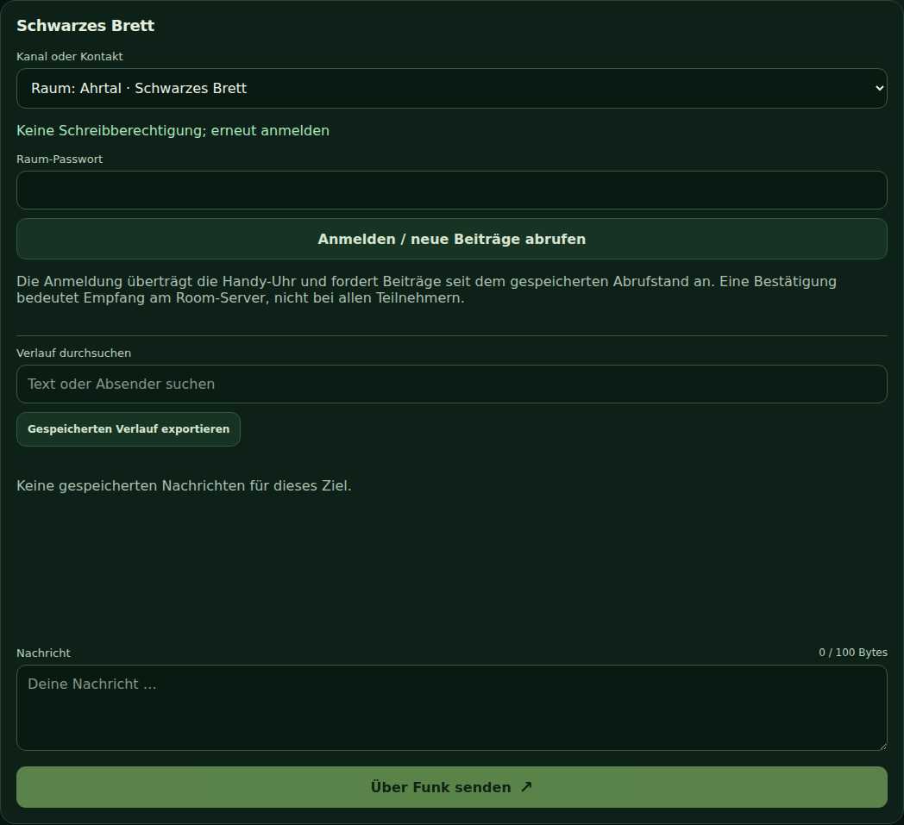](docs/images/funktion-brett.png)

### Hilfe, Angebot und Information vorbereiten

Meldungen mit Ort, optionalen Koordinaten und sichtbarer Ablaufzeit erstellen. Erst der normale Sendeknopf überträgt den vorbereiteten Text. Keine automatische GPS-Erfassung.

[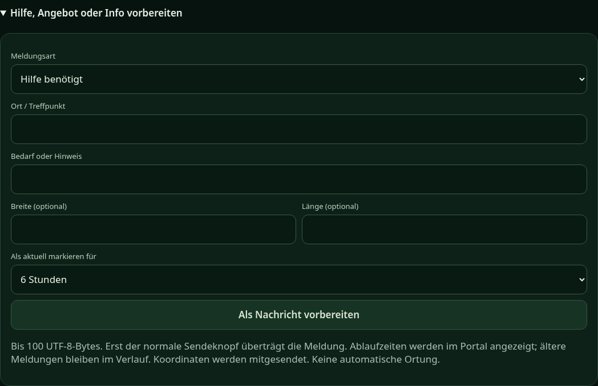](docs/images/funktion-meldungen.png)

### Offlinekarte und automatischer Download

Der korrigierte Startausschnitt zeigt **das tatsächliche Heimersheim mit Heppingen und Umgebung**. Das Regionalpaket reicht für nahe Versorgung bis Bad Neuenahr und enthält **6.843 Geoobjekte**, ca. **2,4 MB**. Straßen, Wege, Gebäude, Gewässer, Ortsnamen, Nordhinweis und Maßstab werden lokal gezeichnet. Zusätzlich gibt es eine Übersicht des gesamten Ahrtals von Blankenheim bis zur Mündung, ohne Gebäude und ohne Routenberechnung.

Download und tägliche Aktualisierung laufen nur bei **geöffneter App**, aktivierter Automatik und erreichbarer Internetverbindung, auch über mobile Daten. Im Board-WLAN ohne Internet bleibt eine zuvor gespeicherte Karte nutzbar. Nach dem Update eine alte Karte einmal über **„Heimersheim herunterladen“** ersetzen. [Bedienung und Speichergrenzen](docs/AUTOMATISCHE_KARTEN.md).

[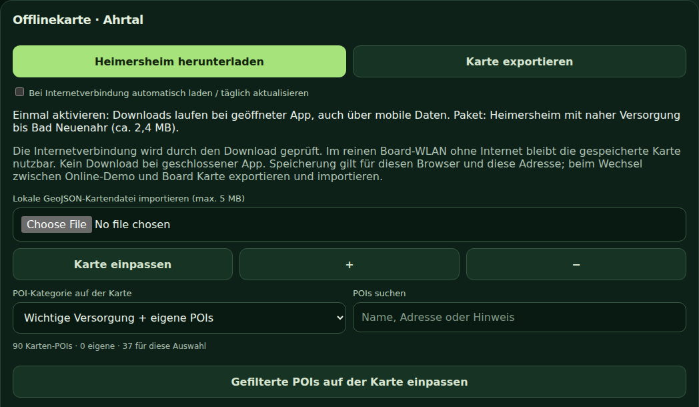](docs/images/funktion-kartendownload.png)

[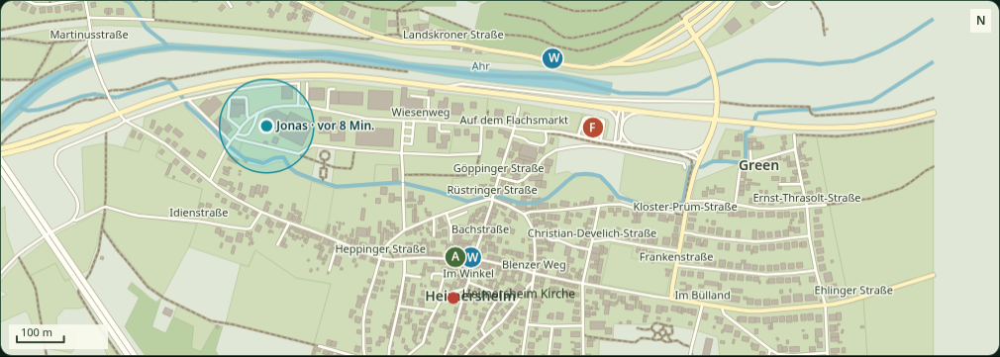](docs/images/ahrtal-map.png)

[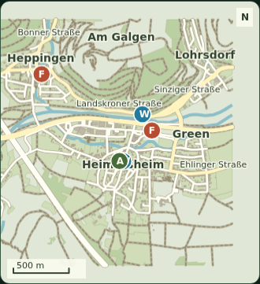](docs/images/heimersheim-map.png)

### Wasserstellen, Apotheken, Feuerwehr und ärztliche Versorgung

**90 reale OSM-Einträge** im Regionalpaket: 4 Wasserstellen, 6 Apotheken, 3 Feuerwehrstandorte, 24 medizinische Einrichtungen, 18 Lebensmittel-Orte, 9 Toiletten und 26 Unterstände. Kategorien und Suche grenzen die Anzeige ein; Marker und Liste öffnen Details mit Quelle und Datenstand.

**Wasser ist nicht automatisch trinkbar.** Öffnung, Zugang, Notdienst und Besetzung sind nicht live geprüft. Arztpraxen und Feuerwehrhäuser sind keine Garantie einer verfügbaren Notfallversorgung. [POI-Anleitung und Grenzen](docs/POI_KARTE.md).

[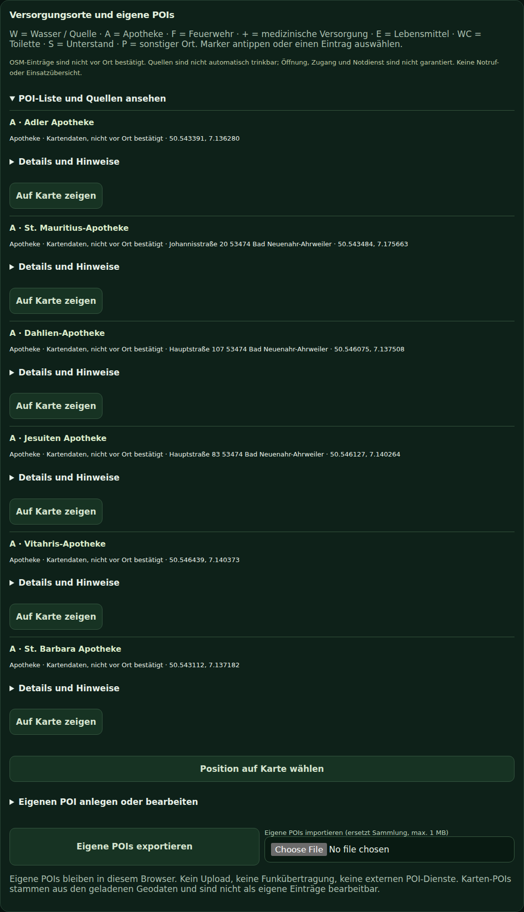](docs/images/funktion-versorgung.png)

### Eigene Alltags-POIs

Treffpunkte und andere eigene Orte per Kartentipp oder Koordinaten speichern, bearbeiten und löschen. GeoJSON-Export/-Import sichert die Sammlung. Eigene Einträge bleiben von den Karten-POIs getrennt; kein Upload, keine Funkübertragung und kein Mundraub-Dienst. Im Bild ist ein **ungespeicherter Beispielentwurf** zu sehen.

[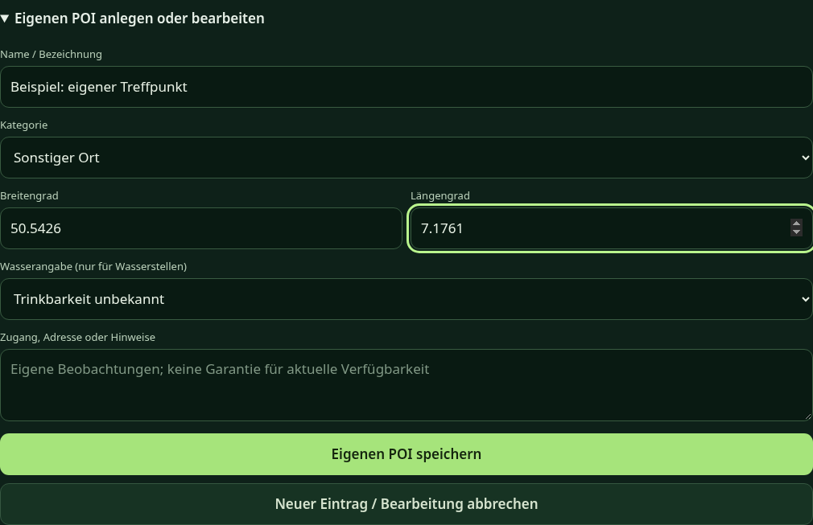](docs/images/funktion-eigene-pois.png)

### Optionale eigene Erntefundorte

Obst, Nüsse, Beeren und Kräuter mit Erntemonaten und Zugangshinweisen lokal eintragen; nach Kategorie und Saison filtern sowie exportieren/importieren. Keine externe Fundort-Datenbank angebunden.

[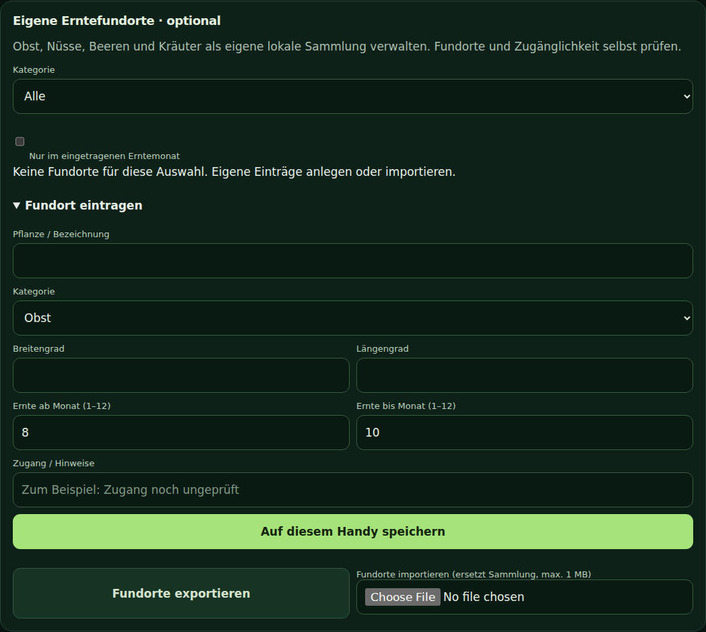](docs/images/funktion-erntefundorte.png)

### iPhone-Webapp

Mit dem Board-WLAN verbinden und in Safari `http://192.168.4.1` öffnen. Über **Teilen → Zum Home-Bildschirm** hinzufügen. Chat und Einstellungen benötigen weiterhin die Verbindung zum Board. Das Bild zeigt die Handyansicht im Browser; die echte iOS-Abnahme bleibt offen. [Webapp-Einrichtung](docs/AHRTAL_WEBAPP.md).

[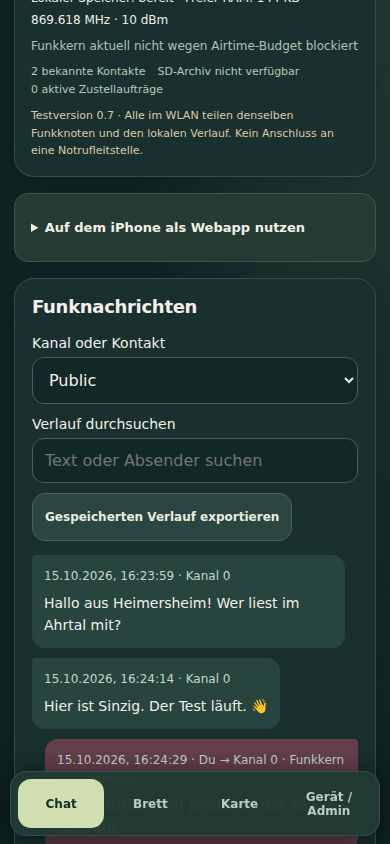](docs/images/ahrtal-iphone.png)

### Adminzugang

WLAN-Passwort und Adminpasswort sind getrennt. Jedes Board erzeugt ein eigenes Adminpasswort, das bei der Einrichtung über USB ausgegeben wird. Funk- und Kanaleinstellungen sind bis zur Anmeldung gesperrt; nach 15 Minuten erneut anmelden.

[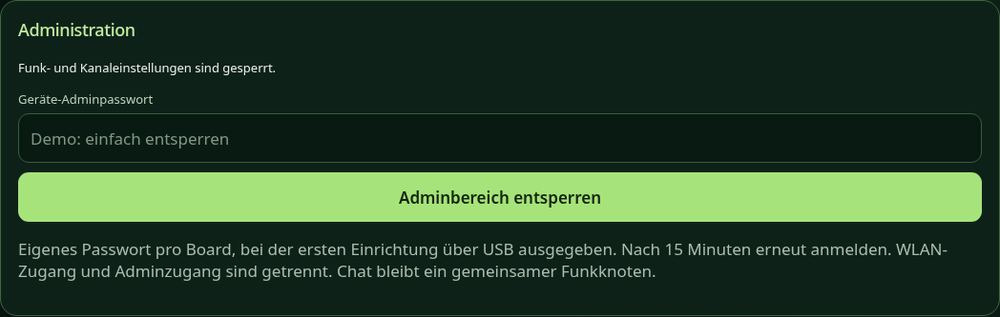](docs/images/ahrtal-admin.png)

### Gerätediagnose

Firmwareversion, Laufzeit, Resetgrund, RAM, WLAN-Clients, TX/RX-Zähler und internes Airtime-Budget ansehen und als JSON-Momentaufnahme speichern. Der Windows-Recorder kann JSONL-Aufzeichnungen erstellen. [Diagnose und Grenzen](docs/FUNKLAST_DIAGNOSE.md).

[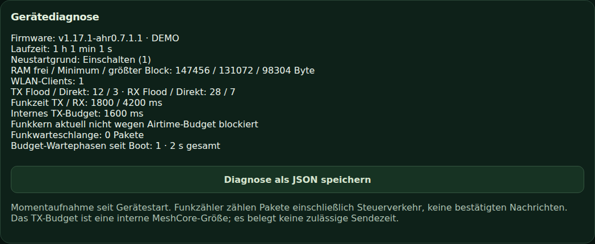](docs/images/funktion-diagnose.png)

### Zustellaufträge und optionales SD-Archiv

Aufträge und Status prüfen; bei passender SD-Firmware die zwei letzten Archivsegmente herunterladen. Die Demo zeigt die Oberfläche mit leerer Warteschlange und ohne SD-Karte. [Einrichtung und Grenzen](docs/OFFLINE_SD_KARTEN.md).

[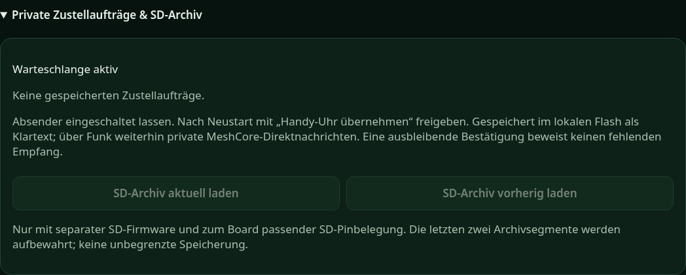](docs/images/funktion-auftraege-sd.png)

### Knoten und Verbindung

Knoten benennen, Bekanntgabe senden, Kontakte neu lesen und Handy-Uhr übernehmen. Beide Funkpartner müssen dieselben Funkparameter und passende Kanalschlüssel verwenden.

[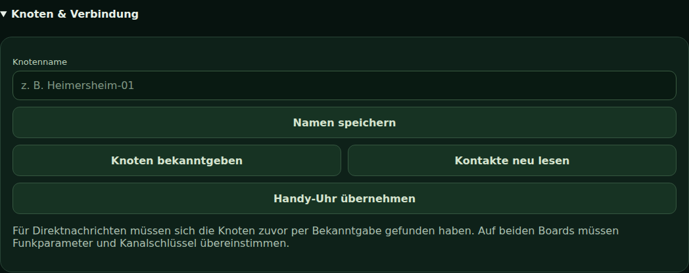](docs/images/funktion-knoten.png)

### Chatkanäle einrichten

Public oder eigene Gruppen wie Ahrtal und Heimersheim konfigurieren. Regionale Namen sind Vorlagen für das eigene Netz, keine automatisch abonnierten öffentlichen Regionalkanäle. Private Gruppen benötigen einen gemeinsam vereinbarten Schlüssel.

[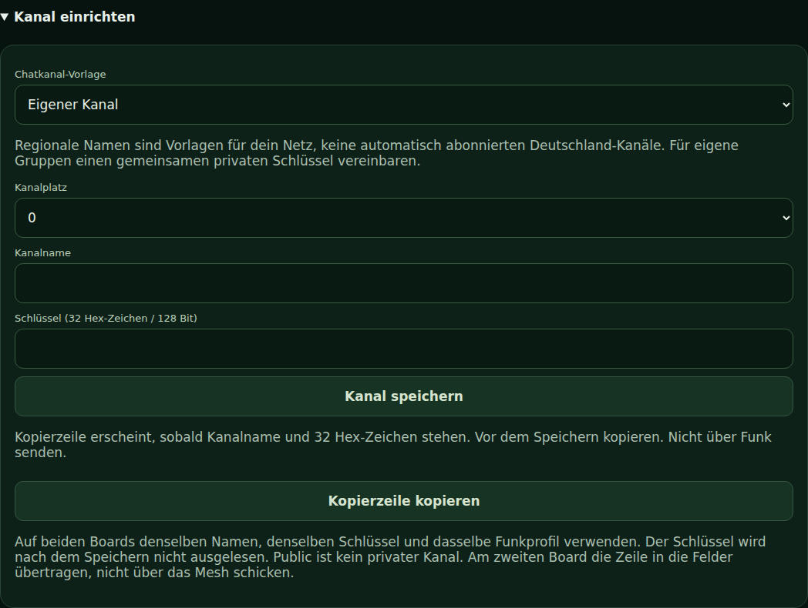](docs/images/funktion-kanaele.png)

### Funkprofile für 868-MHz-Hardware

Vorgegebene Profile auswählen und Frequenz, Bandbreite, Spreading Factor und Coding Rate prüfen. Alle Knoten müssen dasselbe Profil verwenden. Profilwechsel setzt die Sendeleistung auf 10 dBm; das interne Budget ersetzt keinen messtechnischen Konformitätsnachweis. [Profile und Betriebshinweise](docs/AHRTAL_WEBAPP.md).

[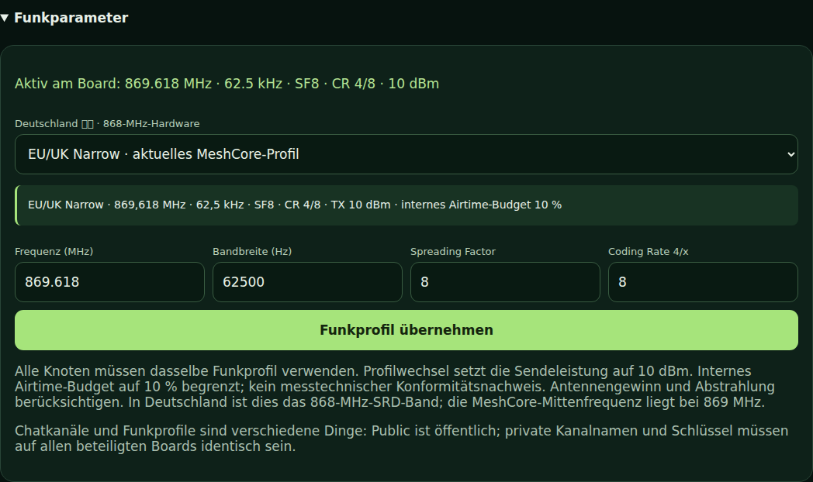](docs/images/funktion-funkprofile.png)

## Hardware und Installation

Zielhardware: **fünf LILYGO T3-S3 V1.3 mit ESP32-S3, SX1262 und 868-MHz-Antenne**.

| Boards | Rolle | Paket |
|---|---|---|
| A und B | WLAN-Portal | `wifi` |
| Optional für ein Portal | WLAN-Portal mit SD-Archiv | `wifi_sd` |
| C und D | Separate Weiterleitung | `repeater` |
| E | Schwarzes Brett / Raumserver | `room` |

[**Geprüfte Firmwarepakete und Windows-Schritte**](docs/STARTPAKET.md) · [Flashen mit Backup](docs/SX1262_PAKET.md) · [Board, Pins und Stromversorgung](docs/SX1262_BOARD.md) · [Fünf-Board-Aufbau](docs/T3S3_V13_WINDOWS.md)

1. Einstellungen und vollständigen Flash der bisherigen Firmware **lokal sichern**.
2. Beim ersten Wechsel die passende Erstinstallation mit Sicherung verwenden.
3. Bei bestehendem DisAHRsterRadio mit gleicher Rolle nur die Anwendung aktualisieren; **kein `uploadfs`**. Das erhält Knotenidentität, WLAN-Zugang, Verlauf und Warteschlange.
4. USB-Seriellmonitor mit 115200 Baud öffnen; WLAN-Name und Passwörter ablesen.
5. Handy mit `DisAHRsterRadio-XXXXXX` verbinden und `http://192.168.4.1` öffnen.
6. Knoten benennen, Uhr übernehmen, Funkprofil und Kanäle abstimmen.
7. Erst direkt zwischen zwei Boards prüfen, danach Repeater und Room ergänzen. [Abnahmeprotokoll](docs/ABNAHME_ZWEI_BOARDS.md).

Separate T3-S3/SX1276-Profile und ältere TTGO LoRa32 V2.1_1.6 / SX1276 bleiben unterstützt. Sie sind andere Hardwarevarianten; deren Firmware nicht auf SX1262-Boards flashen. Companion-Portale dieser Version leiten fremde Nachrichten nicht als Repeater weiter. Meshtastic-Knoten kommunizieren nicht direkt mit dieser Firmware.

## Prüfstand und bekannte Grenzen

Der geprüfte Laufzeit-Quellstand ist `ead206f67d0fc09b82efed478456dbbdc1c73c4d`: [acht T3-S3-Profile](https://github.com/Pietwars/DisasterMesh/actions/runs/38814785962), [vier TTGO-Profile und Browser](https://github.com/Pietwars/DisasterMesh/actions/runs/38814855434), [Windows-Prüflauf](https://github.com/Pietwars/DisasterMesh/actions/runs/38814785917). Exakte Artefakte und Metadaten: [Startpaket](docs/STARTPAKET.md) und [Prüfnachweis](docs/PRUEFSTAND_2026-10-15.json).

- Funk, Reichweite, Flash-Wiederherstellung, Stromausfälle, SD-Gleichzeitigkeit und echtes iPhone-Verhalten müssen noch an Hardware geprüft werden. Grenzen: [iPhone](docs/IOS_REALITAET.md), [Strom](docs/STROM_UND_SCHLAF.md).
- Keine automatische GPS-Erfassung, Navigation, weltweiten Kartenkacheln, Dateien über Funk oder Benutzerkonten. Die Übersicht `ahrtal.geojson` zeigt das Tal von der Quelle bis zur Mündung ohne Gebäude. Detailpakete: Heimersheim mit Gebäuden, dazu Straßenpakete Altenahr, Dernau/Ahrweiler und Sinzig. Vor einem Ausfall laden.
- WLAN-Nutzer teilen die Knotenidentität. Der Verlauf ist lokal auf dem Board, unverschlüsselt, kein netzweit synchronisiertes Archiv. Ein Admin kann den Flash-Ring löschen.
- Nachrichten im Flash, eigene Browser-POIs und Exporte sind unverschlüsselt gespeichert. Exporte können private Ortsdaten enthalten.
- Kein privates Relais-Postfach für einen ausgeschalteten Absender und keine Priorisierung von Hilferufen auf der Funkstrecke. Das Brett zeigt aktuelle Hilfe nur in der Ansicht oben.
- Unter `dist/` liegen keine Firmwaredateien mehr. Der alte Stand 0.1 wurde entfernt. Für 0.7.1.1 die verlinkten Actions-Pakete verwenden. 0.7.2 aus dem Quellstand bauen, bis ein neues Artefakt abgenommen ist.

[Entwicklungsplan](docs/ENTWICKLUNGSPLAN.md) · [Windows-Entwicklung](docs/WINDOWS_MVP.md) · [Vollständige Validierung](docs/VALIDIERUNG.md)

## Entwicklung und Vorschauen erzeugen

Python 3, Node.js, Git und PlatformIO werden benötigt.

```sh
python -m pip install platformio==6.2.0
npm ci
python tools/embed_web.py
npm test
python tests/tools.test.py
python -m platformio run -j 2 -d firmware/MeshCore -e disaster_t3s3_sx1262_wifi
```

Browserprüfungen und aktuelle README-Aufnahmen ohne Board:

```sh
npx playwright install chromium --only-shell
npm run test:browser
python tools/build_demo.py
node tools/capture_previews.cjs
```

`web/` ist die Quelle der Oberfläche. `tools/embed_web.py` erzeugt daraus die Firmware-Seite `PortalPage.h`; Änderungen anschließend neu kompilieren. `tools/build_demo.py` baut die eigenständige Demo mit simulierter API. `tools/capture_previews.cjs` fotografiert die einzelnen Bereiche nach `docs/images/`; optional lässt sich mit `PREVIEW_CHROMIUM` ein vorhandener Chromium-Pfad wählen.

## Aufbau, Quellen und Lizenzen

- `firmware/MeshCore/`: mitgelieferter MeshCore **v1.17.1**, Quellstand `d92964352441e53b93e8667b802e04f6e072b39e`, mit Original-Lizenz und eigenen Boardprofilen. Kein Submodul, damit der ZIP-Download baubar bleibt. [Warum](docs/UPSTREAM.md).
- `firmware/MeshCore/platformio.local.ini`: Portal-, SD-, Repeater- und Room-Profile.
- `firmware/MeshCore/examples/companion_radio/DisasterPortal.h`: lokale HTTP-zu-Companion-Anbindung.
- `web/`: Oberfläche, Karten, lokale POI-Verwaltung und Protokolldekodierung.
- `maps/`: regionale OSM-Geodaten, Quellen und ODbL-Lizenz.
- `tests/`, `tools/`, `docs/`: Prüfungen, Paket-/Flashwerkzeuge und Anleitungen.

[MeshCore-Upstream](https://github.com/meshcore-dev/MeshCore) · [Ideengeber DisAHRsterRadio / disaster-radio](https://github.com/sudomesh/disaster-radio) – kein Quellcode aus disaster-radio übernommen; der alte Funkstack wird nicht verwendet.

Eigene Ergänzungen: MIT, siehe [LICENSE](LICENSE). Mitgelieferte Komponenten behalten ihre ursprünglichen Lizenzen: [MeshCore](firmware/MeshCore/license.txt), [Abhängigkeiten](docs/dependencies.json), [OSM-Karte / ODbL](maps/README.md). Originalfoto: Pietwars, lokal eingebettet; [Bildhinweise](web/assets/README.md). Die Oberfläche lädt keine externen Bildserver oder CDNs.

Die benötigten Funk-, Crypto-, RTC-, Display- und JSON-Bibliotheken liegen unter `firmware/MeshCore/lib/`; für die ESP32-Werkzeugkette ist beim ersten Build ein Download erforderlich. Eigene Portal-Hooks und Boardprofile sind ergänzt; SPIFFS wird bei Mountfehlern nicht automatisch formatiert.
